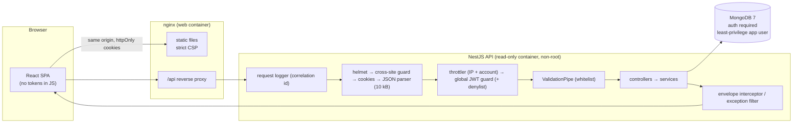
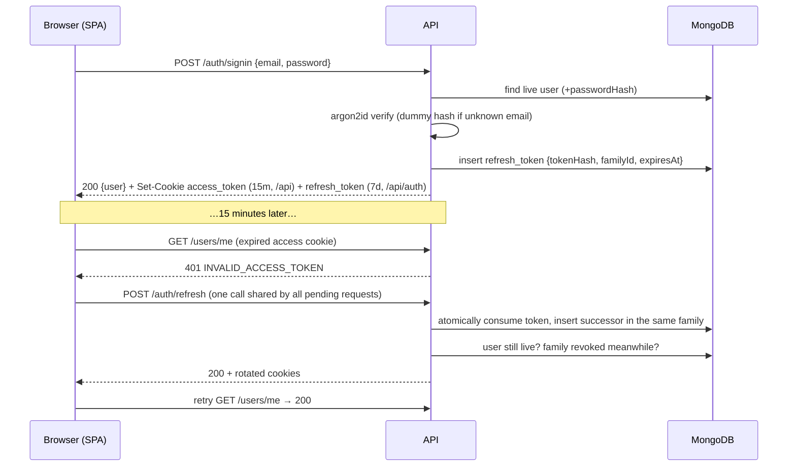
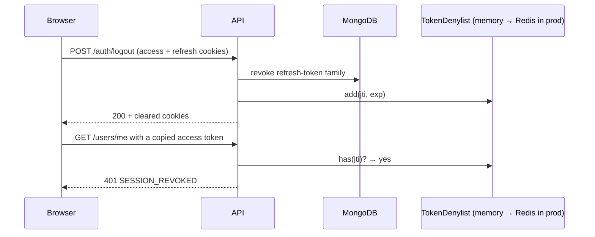

# AI.md: how I built this with AI

> **For reviewers, in 30 seconds**
> - **How I used AI:** Claude Code wrote most of the keystrokes. I set the direction, reviewed everything, and decided when it was done.
> - **Where it went wrong:** the AI got things wrong more often than you'd think. The interesting part is [how those mistakes were caught](#where-the-ai-got-it-wrong).
> - **What changed after my review:** the first version already met the brief. Most of what makes it production-grade came from [my review of that first version](#what-i-asked-for-after-the-first-version).
> - **One disagreement:** on logout, the AI pushed back on my idea, and the result is better than what either of us started with: [the logout discussion](#the-logout-discussion).
> - **System design:** the diagrams, decision records and OWASP review are in the [second half](#system-design).

---

## How I worked

I used **Claude Code** as a pair programmer, with a simple rule: nothing counts as done without fresh output proving it.

1. **Plan before code.** I gave it the brief and asked for a full plan in a Markdown file that I'd approve first: architecture, security, tests, delivery and time budget. That's where the real decisions got made (cookies vs bearer tokens, React, how strict to be). I also challenged it on Mongoose vs Postgres. The brief says MongoDB, so the real question was which MongoDB library, and Mongoose's plugin system later paid off for soft delete.
2. **My own agent playbook.** I keep a set of agent skills from my day job: TDD, "verify before claiming done", systematic debugging and security review. I had them adapted to this stack. They aren't in the repo, because the originals reference internal systems at work.
3. **Tests first, then proof.** Every slice went red, then green, then a full lint, typecheck, test and build.
4. **Revert proofs.** When a test passes on the first run, I don't trust it. For every security control I had the code broken on purpose to see the right test fail, then restored it. That covered the global guard, refresh-token reuse detection, the multi-tab grace window, the CSRF guard, the per-account rate limit, the logout denylist and correlation-id binding.
5. **Independent reviewers.** I ran a separate code-review pass and a separate OWASP audit agent. Neither saw my reasoning, so they couldn't just agree with me.

**What the AI generated:** scaffolding and config, DTOs and schemas, Nest and React boilerplate, most of the tests, Dockerfiles, CI/CD, and first drafts of the docs.
**What I decided:** every item in the [decision records](#decision-records). Where I deliberately went against the usual AI default:

- **Session in httpOnly cookies,** not a bearer token in `localStorage`.
- **No Passport;** a ~30-line guard is enough.
- **One response envelope with stable error codes,** so the UI never parses message text.
- **Soft delete enforced by a plugin,** not by "remember to filter".
- **Honest trade-offs in the README** instead of overclaiming.

## Where the AI got it wrong

Every one of these was caught by running something, not by reading the output and nodding.

| What went wrong | How it was caught | Fix |
|---|---|---|
| A generated Jest config had a comment, `/** … src/**/*.spec.ts */`, that closed itself early | First test run: syntax error | Rewrote the comment |
| It reached for `z.coerce.boolean()`, which turns the env string `"false"` into `true` | Design review | Explicit parsing, plus a test for `"false"` |
| A dependency install failed silently because its output was piped through `tail -1` | `npm ls` before building | Re-ran it and read the full output |
| jsdom 25/27 crash on Node 22.11 | Test runner crashed | Switched to happy-dom |
| Nest's named throttlers apply to every route by default, so the sign-in limit would have throttled the whole API | Checked the docs against the design | Scoped with `skipIf`, with tests |
| Passing an endpoint function straight to TanStack Query would leak Query's context object into the request options | TypeScript, after the API-layer refactor | Explicit wrapper functions |
| nginx's `Host $host` drops the port, so the new same-origin check would have blocked every browser request in Docker | Walked the proxy chain against the CSRF guard | `$http_host`, verified through nginx |
| Requests rejected early (403/413/415) had **no correlation id and no log line**, because `app.use()` middleware runs before the request logger | An e2e test expected an id on a 413 and got `""` | Moved those middlewares after the logger |
| Application log lines were missing the correlation id although the access log had it (pino-http binds the whole `req` by default) | Captured the real JSON log stream in a test | `quietReqLogger: true` |
| nginx overwrote the request id with its own | Traced the header from browser to API | Pass the client's `X-Correlation-Id` through |
| `crypto.randomUUID` doesn't exist on plain-http pages | Reviewed which browser APIs were used | A `getRandomValues` fallback, with a test |
| An empty `SWAGGER_USERNAME=` line in `.env` would have failed boot validation | Wrote the setup script against the env schema | Empty values count as "not set", with a test |
| The Makefile `help` hid `test-e2e`, because the target regex had no digits | Ran `make help` | Fixed the regex |
| Tests guessed `401` for unknown routes; Nest actually returns `404` before any guard runs | Ran them | Fixed the tests, not the code |
| A same-origin test failed because supertest uses a **new random port per request** | Printed the actual host | Pinned `Host` and `Origin` |
| It had pinned nginx to the **1.28** line, two releases behind, so the image carried known nginx CVEs | The first Trivy scan of our own images | Moved to the **1.31** mainline, which has none |
| Both images had fixable HIGH/CRITICAL CVEs that `npm audit` can't see: Alpine packages in the nginx image, and the npm CLI bundled inside the Node base image | Trivy, once I asked for image scanning | `apk upgrade` at build time, and npm/npx/corepack removed from the API runtime image (it only runs `node`). Both images now scan clean |

The code-review pass then found real bugs that **every test had missed**, because the tests made the same assumptions as the code:

- **Shared rate limit:** refresh and logout counted against the sign-in limit, so colleagues behind one office IP could sign each other out.
- **Two tabs looked like theft:** two tabs refreshing at once looked like a stolen token, and the session was killed in both.
- **Oversized bodies:** they returned 500 instead of 413.
- **`npm run dev`:** it never started the web app.
- **Password length:** the web counted it in UTF-16 units and the API in code points, so an emoji password passed the form and then failed the API.
- **Post-sign-in redirect:** it could be dropped.
- **Outage handling:** an API outage looked like being signed out.

The OWASP audit found more (see the [OWASP table](#owasp-top-102025-review)). The lesson: review *after* the tests go green, not instead of writing them.

## What I asked for after the first version

The first version met the brief, but it wasn't what I'd ship. These are the changes I asked for, in order, and why.

**Testing**
- **At least 95% coverage on every branch, enforced in CI.** Coverage only means something if it measures what really runs, so the API's unit and e2e tests count together. Gaps were closed with tests of real paths, never with exclusions. The only excluded files are `main.ts`/`seed.ts` bootstraps and test helpers.

**Schema**
- **An abstract base model:** `createdAt`, `updatedAt` and `deletedAt` on every collection.
- **UUIDv4 ids,** so ids don't leak creation order.
- **Soft delete enforced by a query plugin,** so a forgotten filter can't leak deleted data. Nothing deletes anything yet; that's deliberate groundwork for a delete-account endpoint, or any entity that extends the base model.

**Unification**
- **One response contract for both ends:** `{ success, data, meta }` or `{ success, error, meta }`, with stable error codes.
- **One network layer in the web app:** a `request()` core plus one-line `defineEndpoint` declarations. New endpoints shouldn't mean new fetch code.

**Observability**
- **Logging at every step of every backend endpoint.**
- **A UUIDv4 correlation id generated by the API for every request.** It's on every log line of the request, returned in the response, and shown to users as "Reference: …", so a support ticket leads straight to the logs.
- **One logging component, `AppLogger`.** Developers write a message plus fields. The line shape, redaction and error format are not their problem.

**Security**
- **An OWASP Top 10 review,** with every finding fixed.
- **Swagger on, but not public** once deployed: Basic auth with generated credentials, which the API's config requires in production.

**Delivery and docs**
- **`make demo`:** one command that sets up, starts and seeds everything.
- **CI/CD:** I asked whether "deploy `dev` and `main`, test every PR" was best practice. The AI recommended trunk-based delivery instead, and I agreed (see below).
- **Short "for reviewers" summaries** at the top of the docs.
- **This file in my own voice.**
- **A step-by-step history guide** so the commit history can be rebuilt in order. The [README table](README.md#design-evolution-review-driven-changes) lists all 24 items.

## The logout discussion

I asked to stop storing tokens in the database and keep only logged-out tokens in an in-memory denylist (Redis later). I also asked the AI to push back if that wasn't best practice. It did, and it was right:

- **The refresh token lives 7 days.** An in-memory denylist is wiped on every deploy, so logged-out refresh tokens would quietly start working again. It also isn't shared between instances.
- **We'd lose things that matter.** Without server-side refresh state, there's no rotation with theft detection, no ending a session when the account is deleted, and no future "log out all devices". OAuth 2.0 Security BCP (RFC 9700) and OWASP both recommend revocable, rotating refresh tokens kept on the server.
- **The database only holds SHA-256 hashes,** so a leak gives an attacker nothing usable.

**What we built instead:**
- **Refresh tokens stay server-side.**
- **The access token's `jti` goes on a denylist** until that token would expire anyway. That's the one place a denylist is the right tool. The list is in memory behind an interface, with the Redis commands documented.

**Result:** logout now kills even a copied access token *immediately*, where before it stayed valid for up to 15 minutes, and we gave up nothing.

## The CI/CD discussion

I asked for pipelines that deploy the `dev` and `main` branches and test every PR, and whether that's best practice. The recommendation was: test every PR, yes; one branch per environment, no.

- **Environment branches drift** (cherry-picks, merge-backs).
- **Production gets a different build** from the one tested in dev.
- **Releases become merges** instead of decisions.

**What we built instead:**
- **One long-lived `main`,** with every PR gated by CI and CodeQL.
- **Each image is built once per `main` commit,** scanned, and published with provenance and an SBOM. It then deploys to `dev` automatically.
- **Production promotes that same image** by SHA, after a required approval. Rollback is just promoting an older SHA.

**Not done yet:** the deploy steps are placeholders that print a warning. There's no cloud target in this assessment, and I'd rather say so than fake a deploy.

## Prompts that worked

- **"Plan first, in a file I can approve. No code yet."**
- **"Show me the failing output, not a summary."** Half the fixes above came from reading the real error.
- **"Break it on purpose and show me the test fail."**
- **"Push back if this isn't best practice."** It led to a better logout design than mine.
- **Running independent work in parallel.** The skills adaptation and the OWASP audit ran as background agents while the main build continued.

## Agent skills for contributors

I worked with a set of agent skills from my personal library: reusable instructions that make an AI assistant follow a team's workflow instead of improvising. They aren't in this repo (the originals reference private systems), but if you contribute with an AI assistant, these are the ones that pay off here. Recreate them for your own agent, or use them as a checklist.

| Skill | Use it when | What it makes the agent do |
|---|---|---|
| `change-workflow` | any change | restate the ask → plan behaviours → test first → revert proof → `make verify` → hand-off summary for review |
| `dev-setup-check` | before starting, or when something fails for environment reasons | check Node 22, dependencies, Docker/MongoDB and `.env` files (without reading secrets) |
| `test-driven-development` | implementing anything | write the failing test first, see it fail for the right reason, then the minimum code |
| `verification-before-completion` | before saying "done" | no completion claim without fresh lint/typecheck/test/build output and a runtime check |
| `systematic-debugging` | a test fails or something behaves oddly | find the root cause (logs by correlation id, request pipeline order) before changing code |
| `nest-endpoint` | adding or changing an API endpoint | module, DTO, guard/`@Public()`, envelope, error codes, Swagger, e2e tests (mirrors [API conventions](docs/api-conventions.md)) |
| `jest-nest-patterns` | writing API tests | `createTestApp`, in-memory MongoDB, supertest agents for cookie flows, captured logs |
| `vitest-rtl` | writing web tests | `renderApp`, MSW `ok`/`fail` envelopes, accessible queries |
| `security-review` | reviewing auth, input, cookies or config changes | report only confirmed, exploitable issues, mapped to OWASP |
| `sharp-edges` | reviewing config, env parsing or auth helpers | find footguns where the easy path isn't the safe one (e.g. `"false"` parsed as true) |

The [knowledge base](docs/README.md) holds the project-specific facts these skills rely on: the conventions, flows and checklists.

## What I'd still check by hand before production

- **argon2 cost:** tune the parameters on the real hardware.
- **Cookies behind TLS:** `Secure` and the cookie domain behind the real TLS terminator.
- **Redis:** for rate-limit counters and the access-token denylist once there's more than one API instance.
- **Alerts:** on `auth.refresh.reuse_detected` and on spikes of `auth.signin.failed`.

---

# System design

## Architecture

**One origin.** The browser talks to `/api` on the SPA's own origin: through nginx in Docker, through the Vite proxy in development. That keeps cookies `SameSite=Strict`, keeps CORS closed by default, and removes a whole class of cross-origin mistakes.

## Request lifecycle (API)

| Step | Component | Responsibility |
|---|---|---|
| 1 | `pino-http` (first, on purpose) | Generates a new UUIDv4 correlation id (a client-sent `X-Correlation-Id` is ignored); binds it to every log line; echoes it in the response; writes one access-log line |
| 2 | `helmet` | Security headers |
| 3 | `crossSiteRequestGuard` | Non-GET requests must be JSON (`415`) and same-origin or an allowed origin (`403`) |
| 4 | `cookie-parser`, JSON body parser | Only JSON is parsed; bodies above 10 kB get `413` |
| 5 | `ThrottlerGuard` | `default` 120/min per IP; `auth` 10/min per IP (sign-up/sign-in); `account` 5/min per email (sign-in) |
| 6 | `JwtAuthGuard` (global) | Every route needs a valid access cookie unless `@Public()`; checks signature, `iss`, `aud`, `typ`, expiry, and that the `jti` isn't denylisted |
| 7 | `ValidationPipe` | DTO validation, unknown fields rejected, inputs normalised |
| 8 | `RequestLoggingInterceptor` | Debug trace: handler entered and left, with duration |
| 9 | Controller → service | Business logic; services log domain events through `AppLogger` |
| 10 | `ResponseEnvelopeInterceptor` | `{ success: true, data, meta: { correlationId, timestamp } }` |
| 11 | `AllExceptionsFilter` | `{ success: false, error: { statusCode, code, message, details }, meta }`; unknown errors become a logged, generic `500` |

Steps 2–4 are Nest module middleware, so they run *after* step 1. Requests they reject still get a correlation id and a log line. `/api/docs` sits behind HTTP Basic auth whenever credentials are configured (always, in production).

## Session design

- **Rotation with reuse detection.** A rotated token that shows up again must have been copied, so the whole family is revoked.
- **Grace window for tabs.** Tabs share one cookie and can refresh at the same instant. A just-rotated token is accepted for 10 seconds, unless the session was ended.
- **Logout race.** After inserting a successor, rotation checks whether the family was revoked in the meantime.
- **Account lifecycle.** Refresh re-checks that the user is still live (not soft-deleted).
- **Logout kills both tokens.** The refresh family is revoked in MongoDB, and the access token's `jti` is denylisted until its `exp` (in memory here, Redis in production).

## Decision records

| Decision | Alternatives considered | Why this one | Cost / trade-off |
|---|---|---|---|
| httpOnly cookies, 15-min access JWT + rotating opaque refresh token | JWT in `localStorage`; server sessions | Unreachable by XSS; logout really revokes; access checks stay stateless | More moving parts (rotation, grace window, CSRF defences) |
| Refresh token = 32 random bytes, stored as SHA-256 | Refresh token as a JWT | Revocable per row; a DB leak gives no usable tokens | One DB round trip per refresh |
| Logout: refresh family revoked in DB + access `jti` denylist with TTL | Denylist both tokens, store nothing | Keeps rotation, theft detection and restart-proof revocation; the denylist only covers ≤15-minute tokens | One O(1) denylist lookup per authenticated request |
| Global JWT guard + `@Public()` opt-out | Per-route guards | A forgotten decorator fails closed | Public routes must be marked |
| Own ~30-line guard, no Passport | `@nestjs/passport` | One cookie extractor doesn't justify the abstraction | None that matter here |
| argon2id | bcrypt, scrypt | Memory-hard, OWASP's current recommendation, no 72-byte truncation | Native module |
| Mongoose + abstract base schema | Prisma, TypeORM, native driver | First-class Nest support; plugins make soft delete and UUIDs one central rule | Mongoose typing quirks |
| UUIDv4 string `_id` | ObjectId | No creation-time or ordering leak; portable | Larger index keys |
| Soft delete via a query plugin | Hard delete; manual filters | A forgotten filter can't leak deleted data; groundwork for delete-account | Partial unique index for email |
| One envelope + stable error codes | Raw payloads + HTTP status | One client code path; UI branches on `code`; `correlationId` links a report to the logs | Slightly larger responses |
| JSON-only bodies + Origin/`Sec-Fetch-Site` check | CSRF tokens | With SameSite=Strict and a JSON-only API, forms can't reach handlers | Non-browser clients must send JSON |
| Rate limits per IP *and* per email | Per IP only; lockout | Covers brute force and distributed credential stuffing, no permanent lockouts | A victim's sign-in can be throttled for a minute |
| Server-generated UUIDv4 correlation id per request; client ids ignored | Client-generated ids validated by the API; W3C `traceparent` | Nothing a caller sends can choose or forge the id, so no spoofing and no log injection; the web app has nothing to maintain | A refresh and its retry are separate traces, and offline errors have no reference; `traceparent` is the next step once there are several services |
| `AppLogger` over Nest Logger → pino | Calling the logger directly | Message + fields for developers; shape, redaction and errors enforced in one tested place | Reserved-name fields are moved under `fields` |
| Security middleware after the request logger | `app.use()` in `main.ts` | Early rejections keep their correlation id and log line | Order depends on module middleware (covered by e2e) |
| Swagger behind Basic auth | Docs off in production; network allow-list | Docs stay usable for the team, but not open to the internet | Needs TLS in front (as any deployment has) |
| Validation rules mirrored in zod and class-validator | Shared package | Avoids CommonJS ↔ ESM build plumbing for four rules; identical edge cases tested on both | Two places to update |
| `defineEndpoint` over one `request()` core | Fetch per call; generated client | Each endpoint is one declaration; all network behaviour is tested once | No codegen from OpenAPI yet |
| Makefile as the entry point | README instructions only | `make demo` runs on a clean machine; secrets generated, never printed | Needs `make` (present on macOS/Linux) |
| Trunk-based delivery with image promotion (build once → dev → approved promotion to production) | `dev` and `main` branches deploying to their own environments | Production runs exactly the image that was tested; releases are approvals, not merges; no branch drift; rollback = promote an older SHA | Needs GitHub Environments and branch protection configured once |
| Security gates in the pipeline: CodeQL on PRs, Trivy on images (CI and before publishing), provenance + SBOM | `npm audit` only | Catches what dependency audits can't: vulnerable base-image packages and insecure code patterns. The first scan found real CVEs | A few minutes per pipeline; base images need `apk upgrade` and timely bumps (Dependabot) |
| Combined unit + e2e coverage gate (≥95%) | Unit-only coverage | Measures what really runs | Slower (≈20 s) |

## OWASP Top 10:2025 review

An independent, read-only agent audited the code against each category, sent real requests to the running stack and ran `npm audit`. I fixed every finding test-first, with revert proofs.

| Category | Findings and fixes | Evidence |
|---|---|---|
| **A01 Broken Access Control** | Login CSRF through Nest's default form parser → JSON-only bodies (`415`), Origin / `Sec-Fetch-Site` check (`403`), form parsers removed | e2e: form, text/plain, cross-origin, `Sec-Fetch-Site` |
| **A02 Security Misconfiguration** | MongoDB had no auth → root + least-privilege app user. Swagger was public → behind Basic auth, required in production. Containers `read_only`, `cap_drop: ALL`, `no-new-privileges`, memory limits. nginx 1.31 mainline + `Permissions-Policy`. Package managers removed from the API runtime image. Insecure cookies refused in production | Unauthenticated Mongo read → `Unauthorized`; anonymous `/api/docs` → 401 |
| **A03 Software Supply Chain Failures** | Vulnerable dev dependencies upgraded; CI blocks on prod `npm audit`; **Trivy** fails the build on fixable HIGH/CRITICAL CVEs in the images (it found and we fixed 101 in the base images); **CodeQL** on every PR; images published with **provenance + SBOM** and promoted by digest, never rebuilt; actions pinned to SHAs; Dependabot for npm, actions and Docker | `npm audit` → 0; Trivy on both images → 0 fixable HIGH/CRITICAL |
| **A04 Cryptographic Failures** | Clean: argon2id, SHA-256-hashed random refresh tokens, JWT secret ≥ 32 chars, HS256 pinned | Unit tests |
| **A05 Injection** | Clean: validated strings only; `{ "$ne": null }` → 400; JSON cookies (`j:`) rejected | e2e |
| **A06 Insecure Design** | Per-account sign-in throttle; logout-vs-refresh race closed | e2e + unit |
| **A07 Authentication Failures** | JWT `iss`, `aud`, `typ`, UUID `sub`, `jti`; immediate access-token revocation on logout; soft-deleted users rejected; identical errors and timing for unknown email vs wrong password | e2e |
| **A08 Software or Data Integrity Failures** | Clean: `npm ci` from the lockfile; unknown fields rejected | e2e |
| **A09 Security Logging and Alerting Failures** | No security events were logged → `auth.*` events via `AppLogger`, each with a correlation id, emails only as fingerprints, secrets redacted | e2e reads the real JSON log output |
| **A10 Mishandling of Exceptional Conditions** | A crafted cookie caused a `500` → strict cookie checks; body-parser errors keep their 4xx; outage ≠ signed out | e2e + web tests |

Accepted and documented: `409` on duplicate sign-up, and the in-memory stores (rate-limit counters, access-token denylist) that move to Redis with more than one instance.

## Observability

- **Correlation:** one UUIDv4 per request, generated by the API (client-sent ids are ignored), on every API log line of that request, and returned in the `X-Correlation-Id` header and `meta.correlationId`. The UI shows it as "Reference: …".
- **One line shape:** `{ level, time, service, env, context, correlationId, message, ...fields }` for application logs and the access log alike.
- **Levels:**
  - `info`: outcomes and the access log
  - `warn`: security signals (`auth.refresh.reuse_detected` first) and 4xx
  - `error`: unexpected failures, with the stack trace
  - `debug`: per-step traces, switchable in production with `LOG_LEVEL=debug`
- **Privacy:** no passwords, tokens, cookies or bodies in logs, and emails only as a 12-character fingerprint.
- **Verified on real output:** e2e tests capture the actual JSON log stream.
