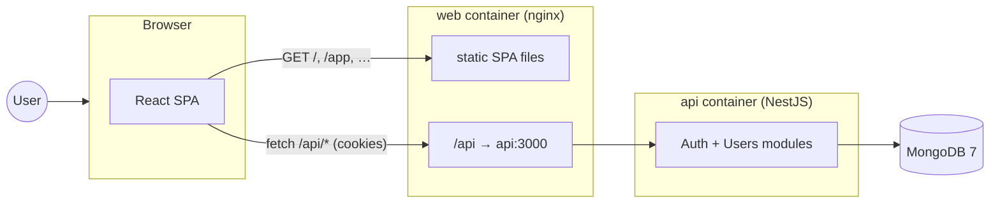
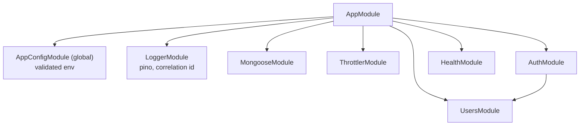
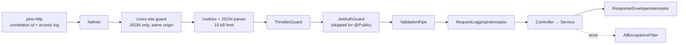

# Architecture

## The system at a glance

- **Three containers:** `web` (nginx serving the SPA and proxying `/api`), `api` (NestJS) and `mongo`.
- **One origin:** the browser only ever talks to its own origin (`:8080` in Docker, `:5173` in development, where Vite proxies `/api`). That is what lets session cookies be `SameSite=Strict` and keeps CORS closed.
- **No tokens in JavaScript:** sessions live in httpOnly cookies, and the SPA never sees them.

## API modules

| Folder | Responsibility |
|---|---|
| [`src/auth`](../apps/api/src/auth) | sign-up, sign-in, refresh, logout; the global JWT guard; refresh-token rotation; the access-token denylist; cookies |
| [`src/users`](../apps/api/src/users) | the user schema, `UsersService`, `GET /api/users/me`, demo seed |
| [`src/health`](../apps/api/src/health) | `GET /api/health` (MongoDB ping) |
| [`src/config`](../apps/api/src/config) | env schema (zod, validated at boot), log format |
| [`src/common`](../apps/api/src/common) | shared building blocks, below |

`src/common`, the pieces every feature reuses:

| Folder | What's in it |
|---|---|
| `database/` | `AbstractSchema` (UUID, timestamps, soft delete) + `createSchema()` |
| `http/` | response envelope, `ErrorCode`, `AppException`, Swagger helpers |
| `logging/` | `AppLogger`, request step logging, email fingerprint |
| `correlation/` | correlation id generation (one per request, server-side only) |
| `security/` | cross-site request guard, Swagger Basic auth |
| `filters/` | global exception filter |
| `decorators/` | `@Public()`, `@CurrentUser()` |
| `validation/` | shared password/name rules, input transforms |

## Request lifecycle

Every API request passes through the same pipeline, in this order:

- **Steps A–D** are middleware ([`app.module.ts`](../apps/api/src/app.module.ts) `configure()`). The logger runs first, so even rejected requests get a correlation id.
- **Steps E–H** are global guards, pipes and interceptors ([`app.setup.ts`](../apps/api/src/app.setup.ts), plus `APP_GUARD` providers).
- **Success** comes out as `{ success: true, data, meta }`; **errors** as `{ success: false, error, meta }`. See [API conventions](api-conventions.md).

## Web app structure

| Folder | Responsibility |
|---|---|
| [`src/api`](../apps/web/src/api) | the only place that talks to the network: `request()`, `defineEndpoint`, error codes |
| [`src/features/auth`](../apps/web/src/features/auth) | sign-up and sign-in pages, zod schemas, TanStack Query hooks |
| [`src/routes`](../apps/web/src/routes) | route table, `ProtectedRoute` / `GuestRoute` |
| [`src/pages`](../apps/web/src/pages) | the welcome page and 404 |
| [`src/components/ui`](../apps/web/src/components/ui) | small reusable UI primitives |

Details: [Frontend](frontend.md).

## Extending it

The seams for the next features already exist. None of these needs a change to the request pipeline, the response contract or the web network layer:

| Feature | Where it plugs in |
|---|---|
| **New endpoint for the web app** | A module with a controller and service ([API conventions](api-conventions.md) has the checklist). Routes are protected by the global `JwtAuthGuard` unless marked `@Public()`. Errors are `AppException` + `ErrorCode`, and the envelope is added for you. On the web side: one `defineEndpoint()` line, a TanStack Query hook, and an `ErrorCode` entry if the UI must react to a new code. 401 refresh, session expiry and correlation ids come for free. |
| **Password reset** | A `password_reset_tokens` collection modelled on `RefreshToken`: random token, only its SHA-256 stored, TTL index on `expiresAt`, consumed atomically with `findOneAndUpdate`. Two `@Public()` routes (request, confirm) under the strict `auth` throttler. The request route always answers `202`, so it can't reveal which emails exist. Resetting revokes every refresh-token family of the user. Needs a mail sender behind an interface (`MailSender`), the same pattern as `TokenDenylist`. |
| **Email verification** | `emailVerifiedAt: Date \| null` on `User`, a token flow like password reset, and either a check in the services that need it or a guard + `@RequireVerifiedEmail()` decorator registered next to `JwtAuthGuard`. |
| **Roles** | `roles: Role[]` on `User` (default `['user']`), a `@Roles(...)` decorator and a `RolesGuard` registered as `APP_GUARD` after `JwtAuthGuard`, which loads the user and compares. Keep roles out of the JWT at first: the access token only carries `sub`, so a role change applies on the next request instead of after the token's 15 minutes. |
| **Permissions per role** | A code-level map `Role → Permission[]` (`'users:read'`, …) and `@RequirePermissions(...)` checked by the same guard. Move the map to a collection only when admins must edit it at runtime. |

Build these when a feature needs them, not before: each is a small, additive change, and an unused roles system is only more surface to secure.

## Tech stack

| Layer | Choice |
|---|---|
| API | NestJS 11, Mongoose 8, argon2, @nestjs/jwt, class-validator, nestjs-pino, @nestjs/throttler, helmet |
| Web | React 19, Vite 6, React Router 7, TanStack Query 5, react-hook-form + zod, Tailwind CSS 4 |
| Data | MongoDB 7 |
| Tests | Jest, supertest, mongodb-memory-server, Vitest, Testing Library, MSW |
| Delivery | Docker, docker compose, nginx, GitHub Actions, GHCR |
| Dev tooling | husky + lint-staged (ESLint, Prettier on commit), commitlint, typecheck on push |
