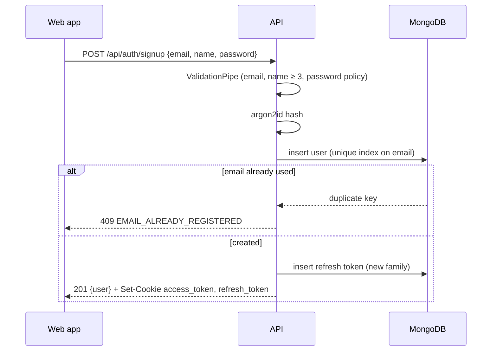
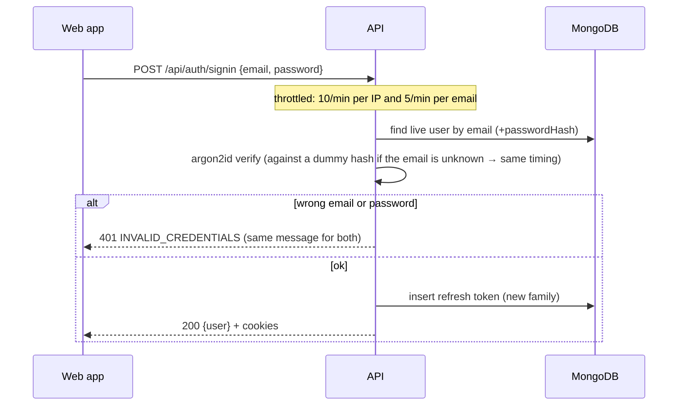
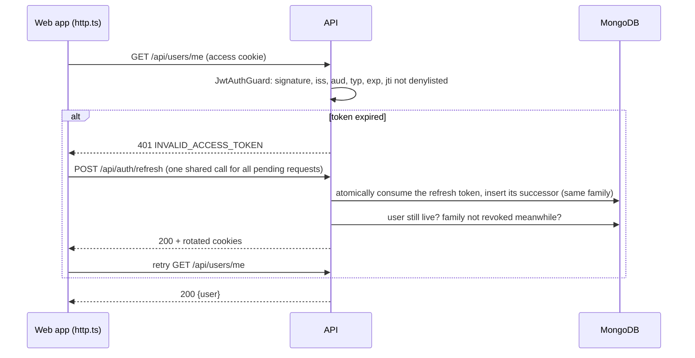
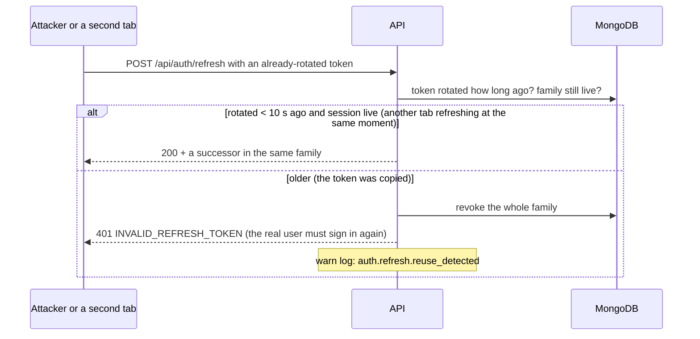
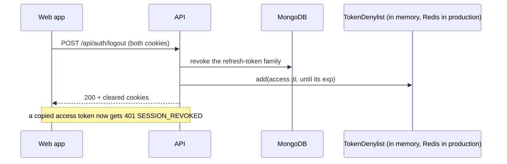
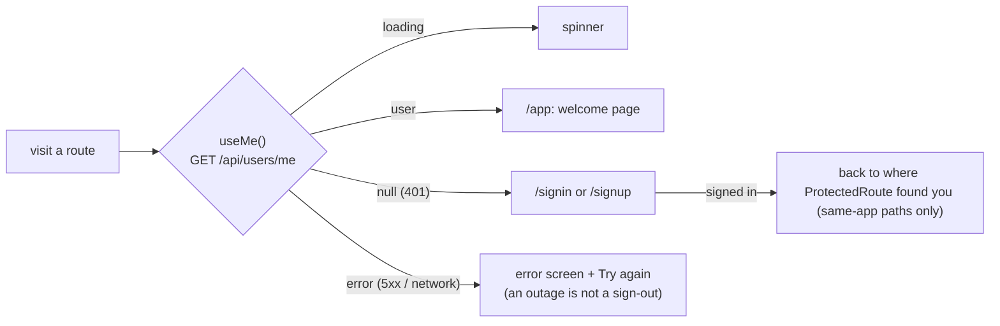

# Auth flows

Sessions use two httpOnly, `SameSite=Strict` cookies. JavaScript never sees either of them.

| Cookie | Contents | Lifetime | Sent to |
|---|---|---|---|
| `access_token` | JWT (HS256) with `sub` (user id), `typ: "access"`, `jti`, `iss`, `aud`, `exp` | 15 min | `/api` |
| `refresh_token` | 32 random bytes (base64url); only its SHA-256 is stored | 7 days | `/api/auth` only |

Code: [`auth.service.ts`](../apps/api/src/auth/auth.service.ts), [`refresh-token.service.ts`](../apps/api/src/auth/refresh-token.service.ts), [`jwt-auth.guard.ts`](../apps/api/src/auth/jwt-auth.guard.ts), [`auth-cookies.ts`](../apps/api/src/auth/auth-cookies.ts).

## Sign up

## Sign in

## Calling a protected endpoint, and silent refresh

## Refresh-token reuse (theft detection) and parallel tabs

## Logout

- **Refresh tokens stay in MongoDB.** They live 7 days, so their revocation must survive restarts and be shared across instances. MongoDB is also what enables rotation and theft detection.
- **Access tokens are denylisted.** They're stateless, so the denylist is the only way to revoke one before it expires. Entries live at most 15 minutes.

## Web routing

Code: [`routes/guards.tsx`](../apps/web/src/routes/guards.tsx), [`features/auth/hooks.ts`](../apps/web/src/features/auth/hooks.ts).
