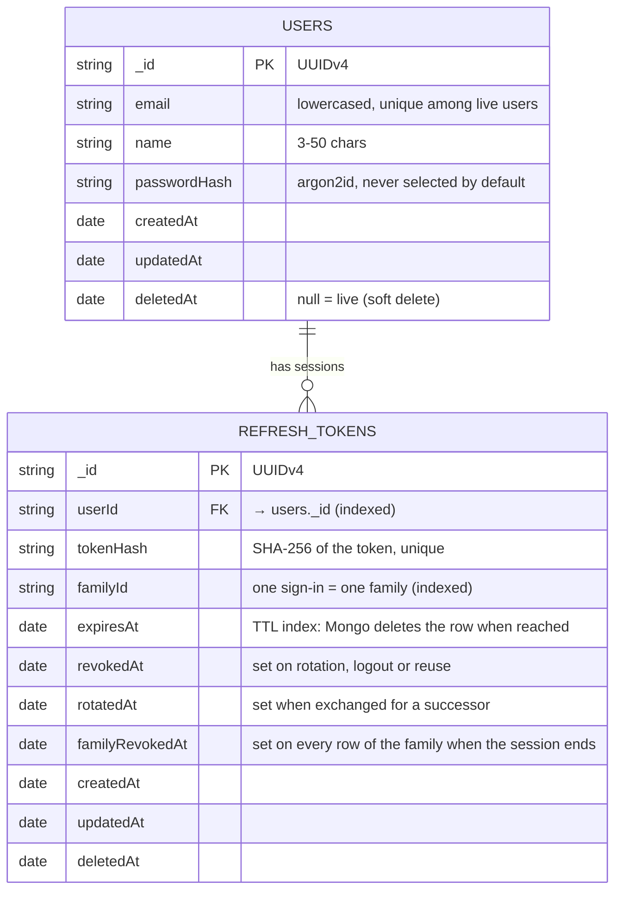

# Data model

MongoDB 7, accessed through Mongoose 8. There are two collections.

## ERD



MongoDB has no foreign keys. `userId` is a reference enforced by the code: refresh checks the user still exists and is live.

## The base schema: every collection extends it

[`common/database/abstract.schema.ts`](../apps/api/src/common/database/abstract.schema.ts) gives every model:

| Field | Behaviour |
|---|---|
| `_id` | UUIDv4 string generated by the server. Exposed to clients as `id`. Never accepted from input |
| `createdAt`, `updatedAt` | Maintained by Mongoose |
| `deletedAt` | Soft delete. A plugin adds `deletedAt: null` to every find, update, count and aggregate, so deleted documents are invisible by default |

Define a new model like this:

```ts
@Schema({ collection: 'projects', ...BASE_SCHEMA_OPTIONS })
export class Project extends AbstractSchema {
  @Prop({ required: true, trim: true })
  title: string;
}
export const ProjectSchema = createSchema(Project); // adds the soft-delete plugin
```

Then inject it as `SoftDeleteModel<Project>`.

### Soft delete

- **Delete:** `await model.softDeleteById(id)` returns `true` if a live document was marked deleted.
- **Read deleted records anyway:** `.setOptions({ withDeleted: true })` on a query, or `{ withDeleted: true }` as the options argument.
- **Groundwork:** no endpoint deletes anything yet. A future delete-account endpoint only has to call `UsersService.softDelete(id)`. Sign-in, `/users/me` and refresh already reject soft-deleted users, and the e2e tests prove it.

## Indexes

| Collection | Index | Why |
|---|---|---|
| `users` | `{ email: 1 }` unique, partial: `deletedAt` is `null` | one live account per email; a deleted account's email can sign up again. The index (not a pre-check) prevents races |
| `refresh_tokens` | `{ tokenHash: 1 }` unique | look up the presented token |
| `refresh_tokens` | `{ userId: 1 }`, `{ familyId: 1 }` | revoke a family; future "log out all devices" |
| `refresh_tokens` | `{ expiresAt: 1 }` TTL (`expireAfterSeconds: 0`) | expired tokens are deleted by MongoDB itself |

## Rules of thumb

- **Validate in the DTO, normalise once.** Emails are trimmed and lowercased in the DTO *and* by the schema.
- **Never return a document.** Map it to a public type ([`toPublicUser`](../apps/api/src/users/user.types.ts)), so internal fields (`passwordHash`, `deletedAt`) can't leak.
- **Let unique indexes decide uniqueness.** Catch Mongo error `11000` and turn it into an `AppException` (see `UsersService.create`).
- **Only store hashes of secrets.** Refresh tokens are SHA-256 hashed; passwords use argon2id.
- **Indexes are created automatically** (`autoIndex`). If you *change* an existing index, drop the old one or run `Model.syncIndexes()`; autoIndex won't replace it.
