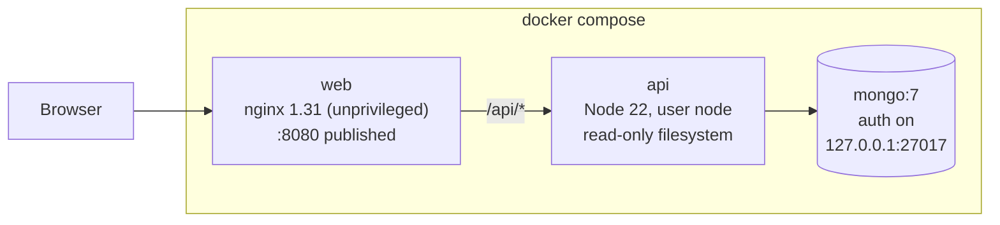
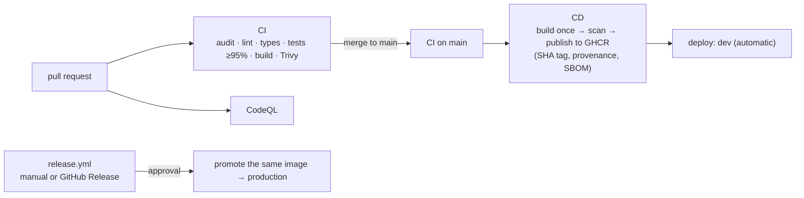

# Infrastructure

## Local environments

| | `make demo` (Docker stack) | `make dev` (hot reload) |
|---|---|---|
| Web | nginx container → http://localhost:8080 | Vite → http://localhost:5173 |
| API | container (production build, `NODE_ENV=production`) | `nest start --watch` on :3000 |
| MongoDB | container | the same container (`docker compose up -d mongo`) |
| Config | root `.env` | `apps/api/.env` |

`make setup` creates both `.env` files with generated secrets and keeps them in sync, so both setups share one database. Secrets are never printed, and existing values are never overwritten. See `make help` for every command.

## Containers

| Image | Build | Hardening |
|---|---|---|
| [`apps/api/Dockerfile`](../apps/api/Dockerfile) | multi-stage: `npm ci` + `nest build`, then prune dev dependencies | runs as `node`; `apk upgrade`; npm/npx/corepack removed from runtime; healthcheck on `/api/health` |
| [`apps/web/Dockerfile`](../apps/web/Dockerfile) | multi-stage: `vite build`, then copy into nginx | unprivileged nginx (uid 101); `apk upgrade` |

[`docker-compose.yml`](../docker-compose.yml) adds:
- **Container hardening:** `read_only`, `cap_drop: ALL`, `no-new-privileges` and memory limits.
- **Health-ordered startup:** mongo, then api, then web.
- **Database access:** MongoDB requires authentication, and the API uses a least-privilege `readWrite` user created by [`docker/mongo/init-app-user.js`](../docker/mongo/init-app-user.js).

### nginx

[`apps/web/nginx.conf`](../apps/web/nginx.conf):
- **SPA:** serves the app with a strict CSP, `X-Frame-Options`, `Permissions-Policy`, immutable caching for `/assets/` and `no-cache` for HTML.
- **API proxy:** proxies `/api/` to `api:3000` with `Host $http_host` (keeps the port, needed by the API's same-origin check), `X-Forwarded-For` and `X-Forwarded-Proto`.
- **Correlation ids:** nothing to do; the API generates them and returns them in the response.

## Configuration

All API settings are environment variables validated at boot by [`env.ts`](../apps/api/src/config/env.ts). The API refuses to start if one is missing or unsafe. The full table is in the [README](../README.md#configuration). The rules that matter most:

- **Secrets come from env only.** `.env` files are gitignored; only `*.env.example` with placeholders is committed.
- **Production refuses unsafe config:** non-`Secure` cookies (unless `ALLOW_INSECURE_COOKIES=true`, for the local demo), Swagger without credentials, and a `JWT_ACCESS_SECRET` or `MONGO_URI` that still contains a `.env.example` placeholder (`change-me` / `CHANGE_ME`).- **Add a setting in three places:** add it to the zod schema in `env.ts` (with a default, if it has one), document it in `apps/api/.env.example` and the README table, and pass it through in `docker-compose.yml` if Docker needs it.

## CI/CD

Trunk-based: `main` is the only long-lived branch, and each image is **built once** and promoted between environments.

| Workflow | Trigger | Purpose |
|---|---|---|
| [`ci.yml`](../.github/workflows/ci.yml) | every PR and every push to `main` | quality gates + image vulnerability scan |
| [`codeql.yml`](../.github/workflows/codeql.yml) | PRs, `main`, weekly | static security analysis |
| [`cd.yml`](../.github/workflows/cd.yml) | CI passed on `main` | publish images, deploy to `dev` |
| [`release.yml`](../.github/workflows/release.yml) | manual (commit SHA) or GitHub Release | approved promotion to `production` |

> ⚠️ **The deploy steps are placeholders.** They must be wired to a cloud provider first; the comments in `cd.yml` show examples for ECS, Cloud Run, Container Apps, Kubernetes and a VM. Everything up to publishing and promoting images works today.

- **Pinned actions:** actions are pinned to commit SHAs, and Dependabot bumps them, along with npm packages and the Docker base images.
- **One-time GitHub setup** (environments, branch protection on `main`): see the [README](../README.md#one-time-github-setup-after-creating-the-repository).
- **Rollback:** run `release.yml` with the previous good commit SHA. Nothing is rebuilt.
