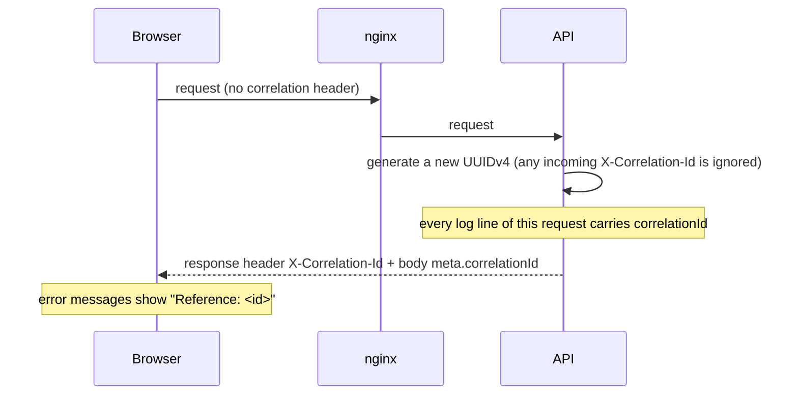

# Logging and tracing

## How to log

Use [`AppLogger`](../apps/api/src/common/logging/app-logger.ts). Never use `console.log`, and don't use Nest's `Logger` directly.

```ts
private readonly logger = new AppLogger(ProjectsService.name);

this.logger.info('Project created', { event: 'projects.created', projectId, userId });
this.logger.warn('Project quota reached', { event: 'projects.quota_reached', userId });
this.logger.debug('Loading project members', { projectId });             // step-by-step detail
this.logger.error('Could not notify members', error, { projectId });     // error first, then fields
```

You write **a meaningful message** and **any extra fields**. `AppLogger` takes care of the rest:
- **Standard fields first:** every line gets `level`, `time`, `service`, `env`, `context` (your class) and `correlationId`. Extra fields can't overwrite them.
- **Redaction:** fields whose key mentions a secret (`password`, `token`, `secret`, `cookie`, `authorization`, `apiKey`, `credential`) are replaced with `[redacted]`, however deeply nested.
- **Errors:** they always look like `err: { type, message, code, stack }`.
- **Empty messages throw,** so every line says something.

### One line looks like this

```json
{"level":"info","time":"2026-11-26T20:30:12.869Z","service":"auth-api","env":"production",
 "correlationId":"b72af977-6bb7-49df-922c-0fef23907df6","context":"AuthService",
 "message":"User signed in","event":"auth.signin.succeeded","userId":"840e08a6-…"}
```

### Choosing a level

| Level | Use for | Examples |
|---|---|---|
| `error` | something broke and needs a human | `http.unhandled_error` (logged by the exception filter, with the stack) |
| `warn` | security signals and expected failures worth watching | `auth.signin.failed`, `auth.refresh.reuse_detected`, every 4xx in the access log |
| `info` | business outcomes; one per meaningful action | `auth.signup.succeeded`, `auth.logout`, the access log line |
| `debug` | step-by-step progress, off in production by default | handler enter/exit with duration, "hashing password", "looking up user" |

Switch on `debug` in any environment with `LOG_LEVEL=debug`, without a code change.

### Privacy rules

- **Never log** passwords, tokens, cookies, authorization headers or request bodies. Redaction is a safety net, not permission.
- **Emails:** log `fingerprint(email)` (12 hex characters of a SHA-256), never the address itself.
- **Name things by id:** prefer `userId` over names and emails.

## Tracing a request: the correlation id



- **Only the API creates ids.** One new UUIDv4 per request ([`correlation-id.ts`](../apps/api/src/common/correlation/correlation-id.ts)); an id sent by a caller is ignored, so ids can't be spoofed and log lines can't be injected through them.
- **One id, one request.** A session refresh and the retry after a 401 are separate requests with their own ids.
- **The web app only reads it**, from `meta.correlationId` or the response header, and shows it as "Reference: …". A request the API never handled (offline, proxy error page) has no reference.
- **Early rejections are logged too.** Requests rejected by early middleware (403/413/415) still get an id, because the request logger runs first.

## Where logs are kept

Logs always go to **stdout** as JSON lines, so `docker logs`, Kubernetes or a hosting platform collect them without any setup. Keeping them for months is a storage decision per host:

| Host | How to keep months of logs |
|---|---|
| A VM or container host with a disk | Set `LOG_DIR`. Every line is also appended to `LOG_DIR/YYYY/MM/YYYY-MM-DD.log` (UTC day, matching the `time` field), e.g. `logs/2026/01/2026-01-15.log`. docker compose mounts the `api-logs` volume at `/var/log/auth-api`. |
| Serverless (e.g. Vercel) | Don't set `LOG_DIR`: the function filesystem is thrown away. Ship stdout to a log store with the retention you need (on Vercel, a Log Drain to Datadog, Better Stack, Axiom, S3, …). |

- **Retention is the host's job.** The app never deletes old files. Compress and delete them with logrotate or a cron job, or ship them to object storage with a lifecycle rule.
- **Find one request across days:** `grep -r <correlationId> $LOG_DIR/2026/01/`.
- **Months are numbers (`01`, not `jan`)**, so folders sort in date order and globs like `2026/0[1-3]/*` work.

## Debugging a production issue

1. **Get the reference.** Ask the user for the "Reference: …" shown in the error, or take the `X-Correlation-Id` from the browser's network tab.
2. **Find every line for it.** Filter the logs by that id: `make logs | grep <id>` locally, or your log platform's `correlationId:"<id>"`.
3. **Need more detail?** Reproduce with `LOG_LEVEL=debug` to see each step and its duration.

## Events worth alerting on

| Event | Why |
|---|---|
| `auth.refresh.reuse_detected` | a refresh token was replayed, which most likely means a stolen session |
| spike of `auth.signin.failed` | credential stuffing or brute force |
| any `error` level | unexpected failure |
| `auth.access_token.revoked_used` | someone is using a token that was logged out |
